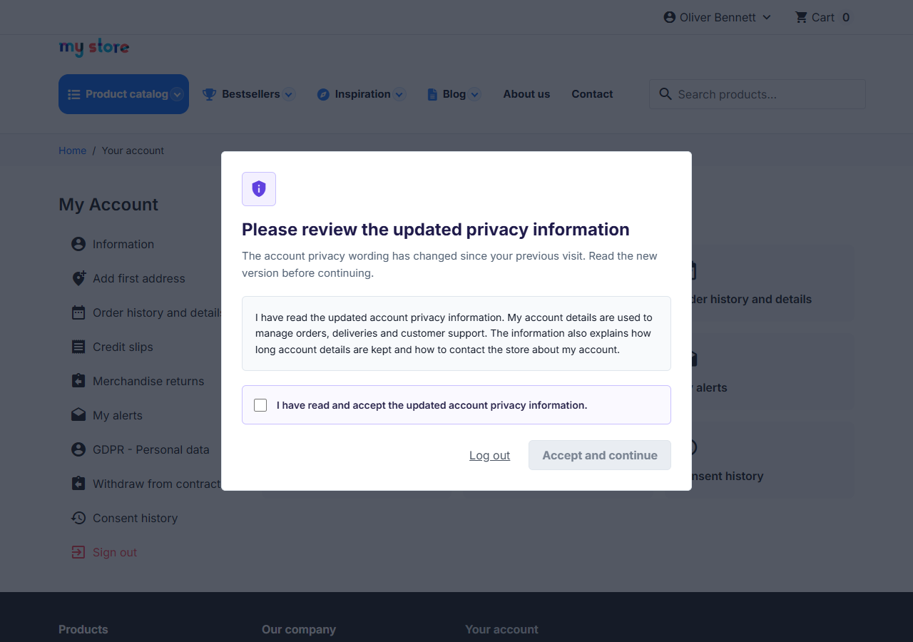
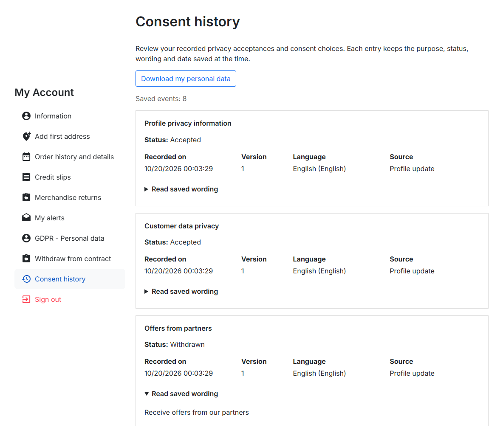
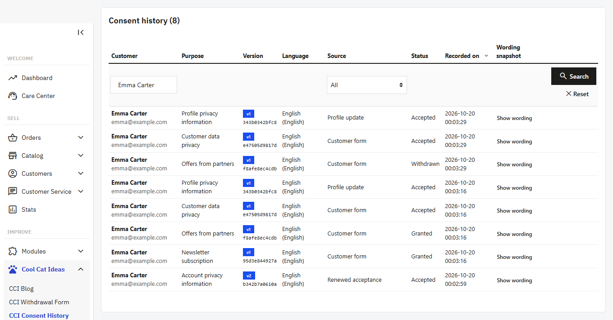
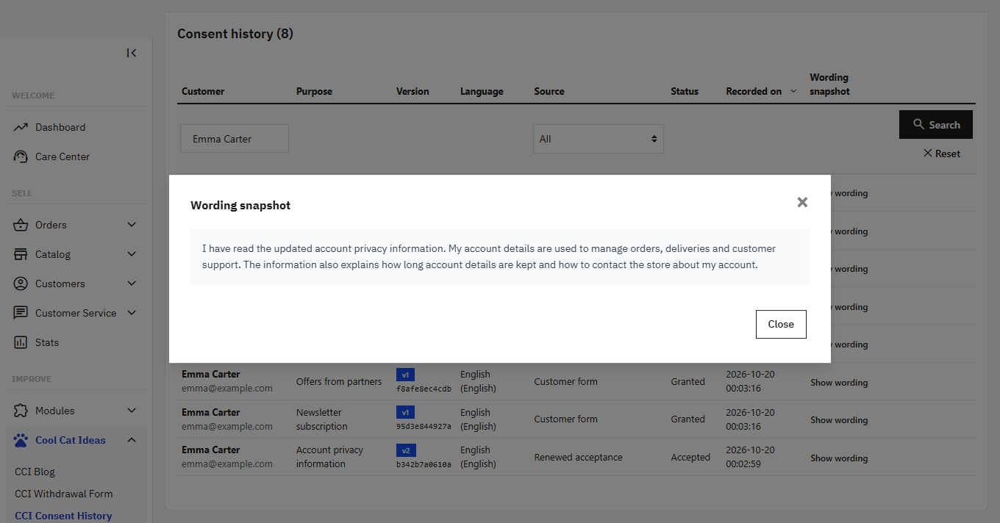

# CCI Consent History for PrestaShop GDPR Module

Check which privacy wording a customer accepted, even after you edit it. CCI Consent History extends PrestaShop's Official GDPR Compliance module (`psgdpr`) with the exact text, language, version and acceptance time. Earlier records remain unchanged. After the account privacy wording changes, the module asks the customer to accept the new version.

Customers can review their own records in **My account > Consent history**. Staff can search the history in the back office. English and Polish administration translations are included.

Download the module ZIP from the [Cool Cat Ideas product page](https://coolcatideas.com/products/cci-consent-history/).

## What it does

- Records the active wording version when a customer creates an account.
- Records the separate profile privacy notice after a successful save in **My account > Information**.
- Records native GDPR checkboxes for modules registered with Official GDPR Compliance, with separate wording versions for each source.
- Keeps newsletter and partner-offer grants and withdrawals from the native customer form.
- Saves the separate Customer data privacy acknowledgement without merging it with the GDPR notice.
- Detects changes made to the account consent in Official GDPR Compliance.
- Shows changed wording after login and asks the customer to accept it before continuing.
- Always lets the customer log out instead of accepting the new version.
- Lets store employees search by customer name or email and open the exact wording snapshot.
- Uses the standard PrestaShop table, search, sorting and pagination in the back office.
- Keeps separate wording versions for every shop and language.
- Supports Classic and Hummingbird themes, and dynamically detects PrestaShop and third-party modules using the standard Official GDPR Compliance checkbox integration.
- Imports earlier records in bounded batches, with saved progress, pause/resume and a CLI worker.
- Offers an optional integration for importing earlier account consents from a supported GDPR module. It is not needed for normal use.

## Set it up

1. Install and enable **Official GDPR Compliance** (`psgdpr`).
2. In its settings, enable the account creation consent and enter the wording for every shop language.
3. Install `cci_consent_history-1.0.0.zip` in **Modules > Module Manager**.
4. Open **Cool Cat Ideas > CCI Consent History**.
5. Leave renewed consent enabled and save.

The wording present during installation becomes the starting version. Existing customers are not stopped on their first visit. If that wording changes later, they must read and accept the new version after login.

Use this flow only for account privacy information that is required to run the customer account. Do not make newsletters, analytics or advertising a condition of account access.

## Optional integration: import earlier account consents

The included integration supports **GDPR - regulacje ochrony danych RODO**, a GDPR module from the Polish PrestaShop vendor **X13**. It is for an in-place shop upgrade where the old tables remain in the same database. Shops that did not use this module can skip the integration.

1. Make a current database backup.
2. Install and configure **Official GDPR Compliance**.
3. Open **Cool Cat Ideas > CCI Consent History**.
4. Check the selected source and its availability in **Import earlier consents**.
5. In **Import earlier consents**, select **GDPR - regulacje ochrony danych RODO (X13)**.
6. Select **Use the source account-consent wording after the import finishes** only if it should replace the current account notice.
7. Confirm the backup and choose **Start import**.
8. Follow the progress. You can pause, refresh the page and resume from the saved batch. Choose **Refresh the acceptance history** after completion.

Closing the page stops browser processing after the current batch. For a job that should continue without the browser, use the CLI or cron instructions in [Import earlier consents](docs/import-consents.md).
The importer copies only account GDPR consent definitions and their acceptance history. It leaves the X13 tables in place, keeps existing CCI history and skips records that were imported earlier. It does not migrate newsletter, analytics, advertising, data-removal or anonymisation workflows.

If the old and new shops use different databases or customer IDs changed during migration, use an assisted SQL migration instead. The in-module importer deliberately does not guess customer matches.

For a different source module, see [write a consent-history importer](docs/custom-integrator.md). Integrations register a contract-version-1 adapter and share the same batch manager, progress panel and CLI worker.

Cool Cat Ideas can also help with a consent-history import or write an integration for another module. [Ask about your source module and shop version](https://coolcatideas.com/contact/).

## Support

Use the product repository under https://github.com/orgs/cool-cat-ideas/repositories for public questions and bug reports. This channel has no guaranteed response time. When you need a private request with an agreed scope, buy a support service on the product page; the request and further messages are then handled in the Cool Cat Ideas customer panel.

CCI Consent History is not affiliated with X13. The importer targets the table structure used by the X13 product named **GDPR - regulacje ochrony danych RODO**.

## Check the history

Open **Cool Cat Ideas > CCI Consent History**. The history shows the customer, date, language, wording version and the saved wording snapshot. Search by name or email when you need to check one customer.

If no current version appears, check that `psgdpr` is enabled and that its account creation consent has both a switch and text for the current language.

## What customers can see

Customers open **My account > Consent history**. Each entry shows its purpose, status, date, wording version, language and source. A choice can be **Granted** or **Withdrawn**. A privacy acknowledgement is **Accepted**. Choose **Read saved wording** to read the text saved at that time. The page shows only the signed-in customer's records from the current shop.

From that page, **Download my personal data** opens the standard **GDPR - Personal data** page. Its CSV and PDF exports include this consent history.

After replacing files in an existing installation, open **Cool Cat Ideas > CCI Consent History** once to register the customer-account link, profile-save hooks and export integration. Do not reset or uninstall the module.

## Privacy checkboxes in the customer profile

Official GDPR Compliance can show a different privacy notice in **My account > Information** from the notice used at registration. Enable it and enter its text in **Official GDPR Compliance > Consent checkbox customization > Customer account**. CCI Consent History stores it separately and labels each successful save **Profile update**.

The privacy checkbox is a confirmation for that form submission. PrestaShop shows it unchecked when the customer opens the form again. The earlier acceptance remains in **My account > Consent history**. A failed save, an unchecked box or simply opening the form does not create an acceptance.

Newsletter and partner-offer checkboxes keep the current choices in the customer record. CCI Consent History also saves their grants and withdrawals after a successful registration or profile save. Saving the same choice again does not create another marketing event. The checkbox from **Customer data privacy block** (`ps_dataprivacy`) has its own acknowledgement and saved wording. This PrestaShop module adds the required **Customer data privacy** checkbox and its explanatory text to registration and profile forms. It does not keep an acceptance history itself. The CCI module header links to the settings of both installed privacy modules.

To check it, open **My account > Information**, select the choices you want, confirm the required privacy boxes and save. Open **My account > Consent history**. You should see separate entries for the newsletter, partner offers and each privacy notice present in the form. Unchecking an earlier marketing choice and saving adds a withdrawal. It does not remove the earlier grant.

The first observed choice is recorded with the time of that successful save. Earlier subscription dates are not guessed. History starts when this integration is active; simply opening the form does not backfill earlier choices.

## GDPR checkboxes in other forms

Open **Official GDPR Compliance > Consent checkbox customization**. Enable the notice for a listed module and enter its text in each shop language. The module's form must display the standard GDPR checkbox. CCI Consent History keeps its wording and records a submission when the customer checks that box and sends the form.

This works with modules using the standard `registerGDPRConsent` and `displayGDPRConsent` integration, such as newsletter, contact, stock-alert and native blog-comment forms. Classic and Hummingbird use their existing form handlers. CCI Consent History sends the event through the native GDPR logging API and saves its historical wording alongside it.

A newsletter form privacy acceptance is not proof that a newsletter subscription was confirmed. An email-delivery error or a later double-opt-in confirmation belongs to that module's own workflow. The history labels the recorded event **GDPR form submission**.

Visitors can use these forms without an account. Their records appear in the back office as **Guest**. They are not automatically assigned to an account after login. The customer history and personal-data exports show only records belonging to the signed-in account and current shop.

Earlier native GDPR logs do not include the wording shown at the time. CCI Consent History does not attach today's text to those earlier events. A module that registers its name with GDPR but uses its own checkbox and logging process needs its own integration; registration alone does not create history.

The list of native GDPR form sources comes from PrestaShop. It is not limited to CCI products or a fixed list of module names. A module added later works through the same standard integration. Own customer-form checkboxes can register with the shared source contract described in [native GDPR integration](docs/native-gdpr-integration.md).

Cookies and checkout terms use separate mechanisms. They are not inferred from GDPR checkbox events. Newsletter privacy acceptance in a standalone form and the subscription choice in the customer profile are separate events.

## See the saved history

The back-office list keeps each acceptance with its customer, language, date and wording version. Open **Show wording** to read the exact text saved with an earlier acceptance.

## Compatibility

- PrestaShop 9.0.0-9.2.0
- Official GDPR Compliance (`psgdpr`)
- AFL-3.0

Release history is available in the [changelog](CHANGELOG.md).
